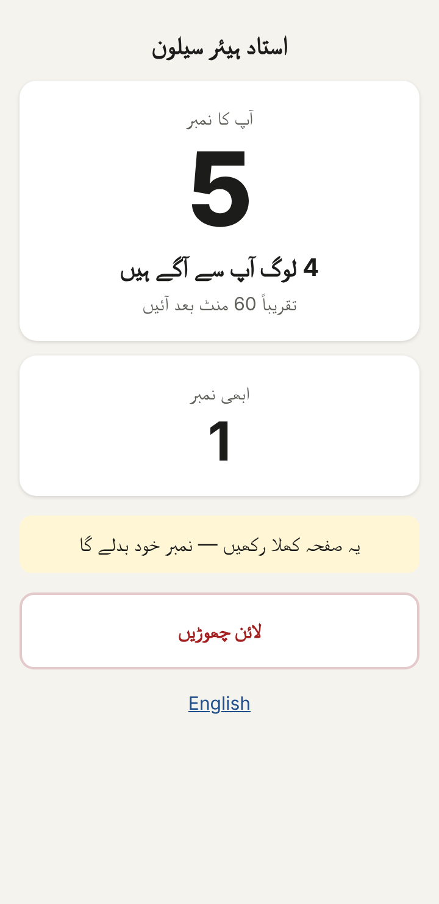
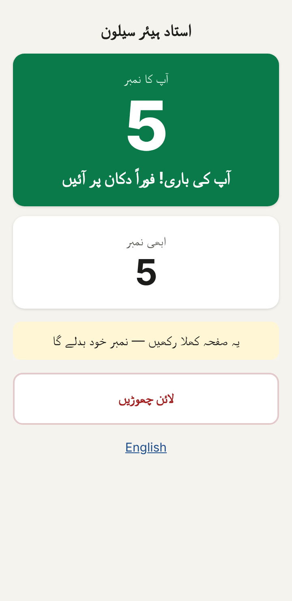
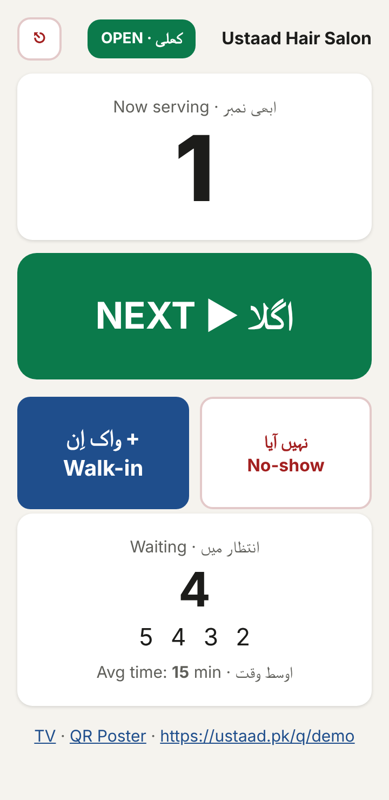

# USTAAD — Live queue for barbershops (no SMS, no app)

Customer scans a QR code and gets a number. The page on their phone updates by itself:
**"Aapka Number 12 — 3 log aage — ~15 minute baad aayein"**.
The barber taps one big **NEXT** button, and every phone and the shop TV update instantly.

Message cost is Rs. 0 per customer. The customer page is about 1.6 KB, so it works on 2G and cheap Android phones. Urdu is the default and English is available.

| Customer | Your turn | Barber | TV |
|---|---|---|---|
|  |  |  |  |

- How it works: [docs/FLOW.md](docs/FLOW.md) (flow diagrams + business rules)
- Roadmap: [PLAN.md](PLAN.md)
- **Deploy free on Render:** [docs/DEPLOY-RENDER.md](docs/DEPLOY-RENDER.md)

## Run it

Needs **Node.js 22.13+**. There's nothing to `npm install`.

```bash
npm run demo        # creates shop "demo" with PIN 1234
npm start           # http://localhost:3000
```

| Page | URL | Who |
|---|---|---|
| Customer | `/q/demo` | Customers (QR code points here) |
| Barber | `/b/demo` | Barber, PIN login |
| TV | `/tv/demo` | Shop TV / old tablet (tap once to enable the ding) |
| QR poster | `/poster/demo` | Print and stick on the wall |

Add a real shop:

```bash
npm run add-shop -- shah-g "Shah G Hair Salon" "شاہ جی ہیئر سیلون" 4821
```

### Settings (environment variables)

| Variable | Example | Purpose |
|---|---|---|
| `PORT` | `3000` | |
| `BASE_URL` | `https://ustaad.pk` | Used in QR codes |
| `SESSION_SECRET` | long random string | Keeps barbers logged in across restarts |
| `COOKIE_SECURE` | `1` | Set when served over HTTPS |
| `DB_FILE` | `/var/lib/ustaad/ustaad.db` | SQLite file location |
| `SHOPS` | `demo \| Ustaad Salon \| استاد سیلون \| 1234` | Shops to create/update on startup (one per line) |
| `TRUST_PROXY` | `1` | Behind a proxy: use the real client IP for the login lock (automatic on Render) |

## Test

```bash
npm test
```

The tests cover the business rules (numbering, ETA, double-tap guard, average learning, daily reset, closed shop) and a full HTTP day, including live SSE updates and the 15 KB page-size budget.
