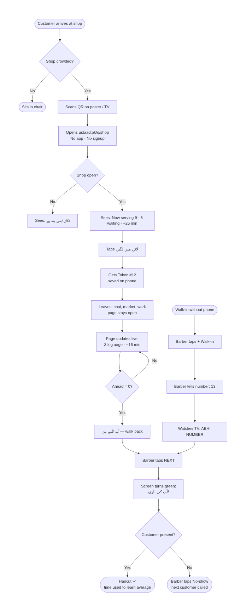
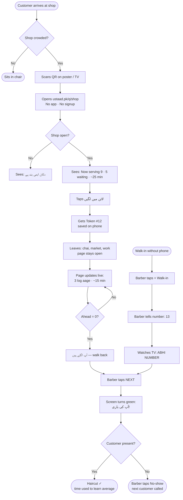
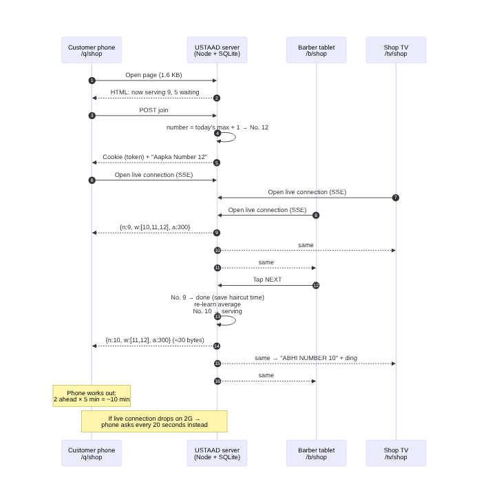
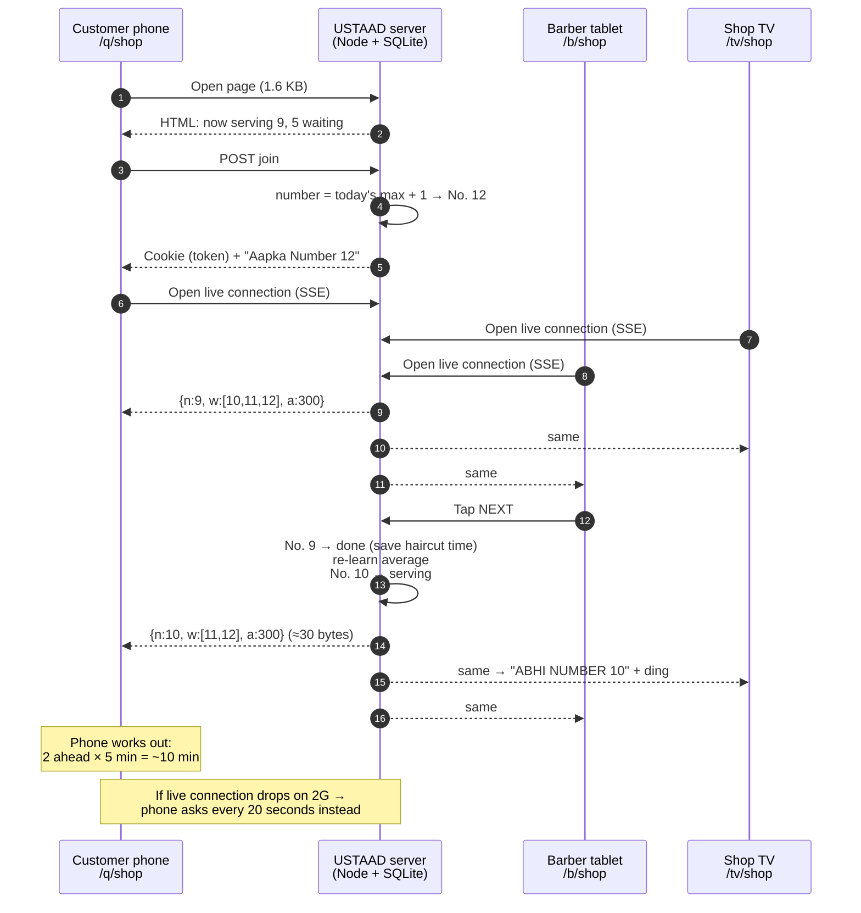
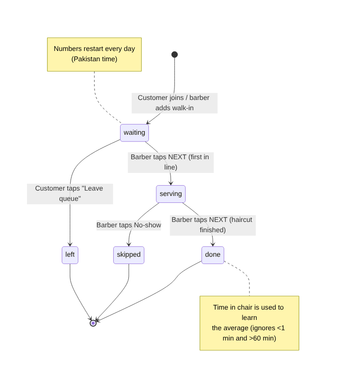
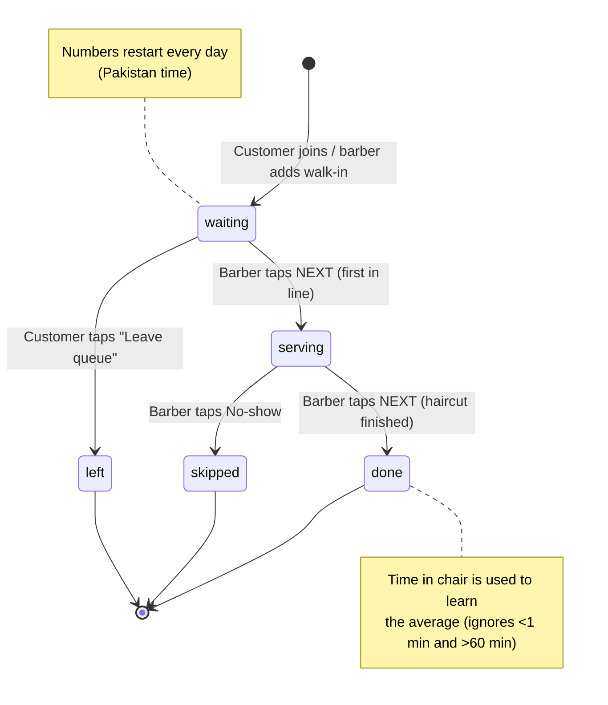

# USTAAD — Flow Diagrams (Phase 0)

## 1. Customer journey (business flow)

## 2. How the system talks (one barber tap → every screen)

## 3. Life of a token

## Business rules at a glance

| Rule | Why |
|---|---|
| Wait time = people ahead × median of last 10 haircuts | Honest ETA that learns each shop's speed |
| Haircuts under 1 min or over 60 min ignored for average | Mis-taps / forgotten taps don't break the ETA |
| NEXT tapped twice within 3 s is ignored | Double tap must never skip a paying customer |
| One active number per phone | Stops one person booking 5 slots |
| Closed shop: phones can't join, barber can still add walk-ins | Barber stays in control |
| Numbers reset daily | Short, easy numbers ("Number 12", not "Number 1,482") |
| Barber login: PIN, 5 wrong tries → 5 min lock | Customers can't press NEXT |
